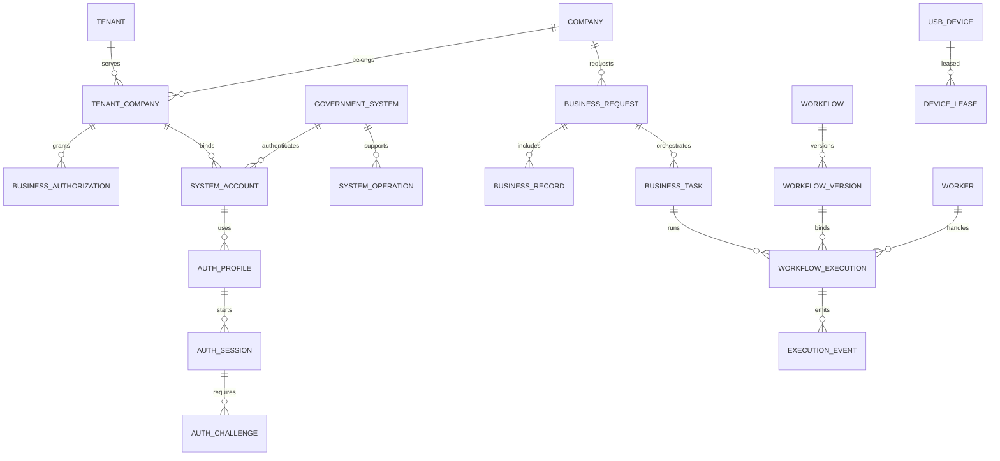

# 数据库 ER 设计 v1.0
PostgreSQL 16+，UUID 主键、UTC timestamptz、EF Core migrations。所有业务表必须带 tenant_id，复合外键与 PostgreSQL RLS 强制隔离。
## 主要关系

## 领域实体
租户：tenants, users, tenant_members, tenant_companies, business_authorizations。
企业：companies, company_contacts。
系统：government_systems, system_operations, system_accounts, auth_profiles, auth_sessions, auth_challenges。
数据与业务：data_sources, data_mappings, business_requests, business_records, business_tasks, routing_rules, routing_decisions。
自动化：workflows, workflow_versions, workflow_executions, execution_events, execution_artifacts, workers。
设备与审计：usb_devices, device_leases, audit_logs。
## 关键约束
- 同一企业允许多个代理租户，但授权、账号、员工业务数据按租户隔离。
- 账号凭据只存 credential_ref；身份证号应用层加密，检索使用带密钥哈希。
- business_requests(tenant_id,batch_key) 唯一；业务记录 Submitted/Unknown 不自动重复提交。
- device_leases 同设备只能存在一个 Active 租约，使用 fencing token。
- 工作流发布后版本不可变，execution 引用版本 ID 与 SHA256。
- 所有日志和对象存储按租户鉴权，敏感字段脱敏。
详细字段定义参见设计交付压缩包中的完整版 ER.md。